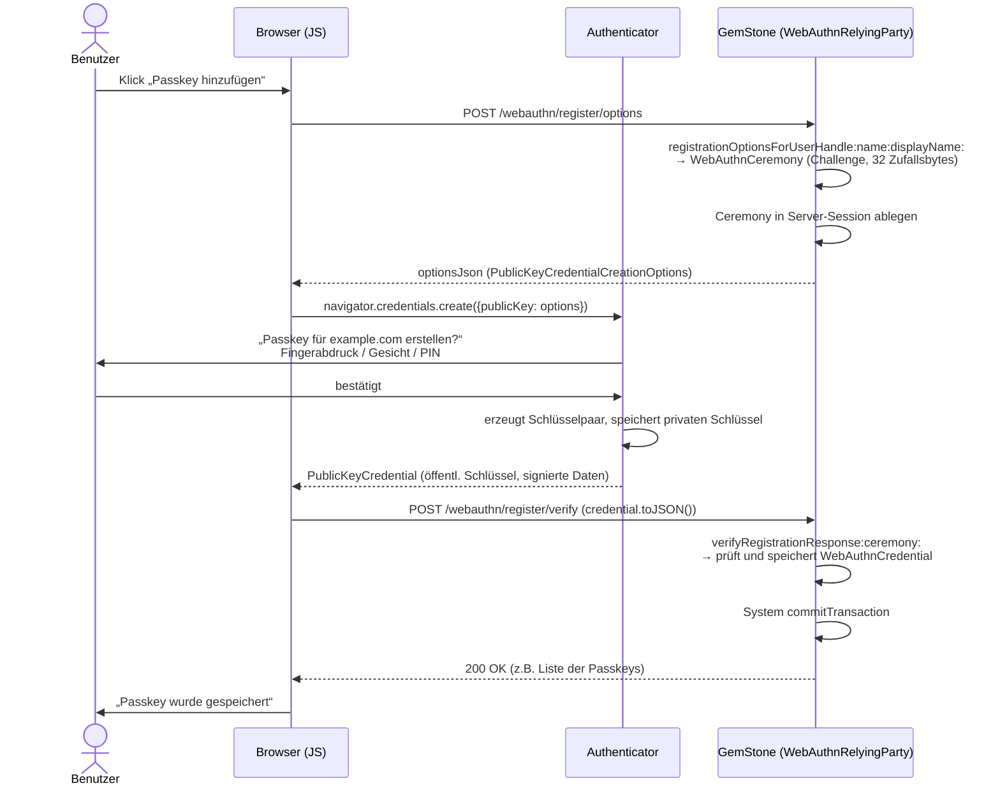
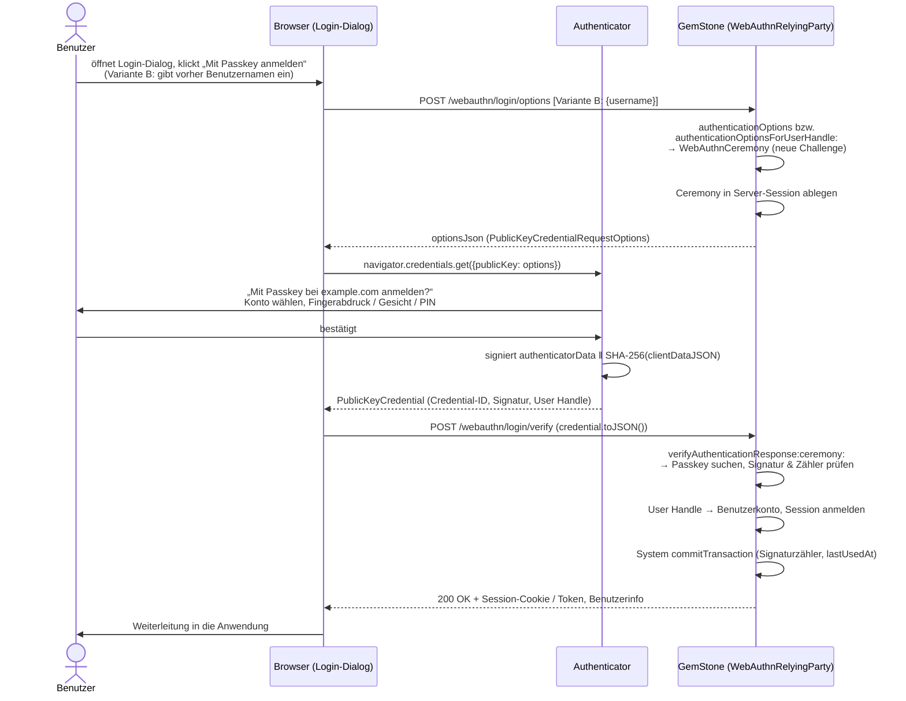

# WebAuthn / Passkeys für GemStone/S

Serverseitige Unterstützung für **Passkeys** (WebAuthn Level 3, FIDO2) in GemStone/S 64. Das Paket erzeugt die Optionen für den Browser, prüft die Antworten von Authenticatoren (Smartphone, Laptop mit Touch ID / Windows Hello, Security-Key) und verwaltet die registrierten Passkeys der Benutzer.

- Registrierung (`navigator.credentials.create()`) und Anmeldung (`navigator.credentials.get()`)
- Anmeldung mit Benutzernamen oder ohne (Discoverable Credentials, Autofill / Conditional UI)
- Algorithmen: **ES256** (ECDSA P-256), **EdDSA** (Ed25519), **RS256** und **PS256** (RSA)
- Attestation `none` und `packed` (Self-Attestation) werden kryptografisch geprüft
- Prüfungen nach WebAuthn-Spezifikation: Challenge, Origin, RP-ID-Hash, User Present / User Verified, Backup-Flags, Signaturzähler (Klon-Erkennung), Zuordnung Passkey ↔ Benutzer
- Einmal verwendbare Challenges mit Ablaufzeit
- Kryptografie ausschließlich mit Bordmitteln von GemStone (OpenSSL über `GsTlsPublicKey`, `sha256SumBytes`, `ByteArray withRandomBytes:`)
- 25 SUnit-Tests mit echten, unabhängig (Python `cryptography`) erzeugten Signaturen

Getestet mit GemStone/S 64 3.7.6 (GLASS/PUM-Image).

---

## Inhalt

1. [Installation](#installation)
2. [Was sind Passkeys? (Kurzfassung)](#was-sind-passkeys-kurzfassung)
3. [Ablauf: Registrierung eines Passkeys](#ablauf-registrierung-eines-passkeys)
4. [Ablauf: Anmeldung über den Login-Dialog](#ablauf-anmeldung-über-den-login-dialog)
5. [Server: Einbindung in GemStone](#server-einbindung-in-gemstone)
6. [Client: JavaScript im Browser](#client-javascript-im-browser)
7. [Was GemStone im Detail prüft](#was-gemstone-im-detail-prüft)
8. [Gespeicherte Daten](#gespeicherte-daten)
9. [Konfiguration](#konfiguration)
10. [Klassenübersicht](#klassenübersicht)
11. [Sicherheitshinweise](#sicherheitshinweise)
12. [Grenzen und offene Punkte](#grenzen-und-offene-punkte)
13. [Tests](#tests)

---

## Installation

Voraussetzung ist ein Image mit Metacello und FileTree (GLASS/GsDevKit). Abhängigkeit ist [`Cbor-Core`](https://github.com/feldti/gemstone-cbor); die Baseline lädt sie automatisch.

```smalltalk
Metacello new
	baseline: 'WebAuthn';
	repository: 'github://feldti/gemstone-webauthn:main/repository';
	load.
```

Aus einem lokalen Checkout:

```smalltalk
Metacello new
	baseline: 'WebAuthn';
	repository: 'filetree:///pfad/zu/gemstone-webauthn/repository';
	load.
```

Danach `System commitTransaction`.

| Paket | Inhalt |
|---|---|
| `WebAuthn` | Bibliothek (Kategorie `WebAuthn-Core`) und Tests (Kategorie `WebAuthn-Tests`) |
| `BaselineOfWebAuthn` | Metacello-Baseline; lädt `Cbor-Core` (Gruppe `Core`) aus `github://feldti/gemstone-cbor:main/repository` |

Die Klassen landen im Standard-Dictionary des Benutzers (üblicherweise `UserGlobals`).

### Wozu CBOR?

Die Authenticatoren liefern ihre Daten nicht als JSON, sondern binär in **CBOR** (RFC 8949). Nur `clientDataJSON` erzeugt der Browser selbst als JSON. Dekodiert werden müssen:

| Daten | Wo | Was darin steckt |
|---|---|---|
| `attestationObject` | Registrierung | CBOR-Map mit `fmt`, `attStmt` (z.B. Signatur der packed-Attestation) und `authData` |
| öffentlicher Schlüssel (COSE_Key, RFC 9052) | in `authData` bei der Registrierung | CBOR-Map mit Integer-Schlüsseln: `1` = Schlüsseltyp, `3` = Algorithmus, `-1` = Kurve bzw. RSA-Modulus, `-2`/`-3` = Koordinaten bzw. RSA-Exponent |
| Extensions | am Ende von `authData`, wenn Flag ED gesetzt | CBOR-Map |

Der COSE-Schlüssel steht in `authData` ohne Längenangabe mitten im Byte-Strom; danach können noch Extensions folgen. Deshalb wird `CborDecoder on:` auf einem Stream benutzt: Der Decoder liest genau ein Element, und der Rest des Streams zeigt, wo der Schlüssel endet. Die rohen Bytes des Schlüssels werden unverändert als `publicKeyBytes` gespeichert.

Einen eigenen CBOR-Encoder braucht das Paket nicht; es erzeugt selbst kein CBOR.

---

## Was sind Passkeys? (Kurzfassung)

Ein Passkey ist ein Schlüsselpaar, das ein **Authenticator** für genau eine Website (die *Relying Party*, kurz RP) erzeugt:

- Der **private Schlüssel** verlässt den Authenticator nie. Er liegt im Secure Enclave / TPM des Geräts, im Passwortmanager (iCloud-Schlüsselbund, Google Passwortmanager, 1Password …) oder auf einem Security-Key.
- Der **öffentliche Schlüssel** wird bei der Registrierung an den Server geschickt und dort gespeichert – in diesem Paket als `WebAuthnCredential` in GemStone.
- Bei der Anmeldung schickt der Server eine zufällige **Challenge**. Der Authenticator signiert sie (nachdem der Benutzer per Fingerabdruck, Gesicht, PIN oder Geräte-Entsperrung zugestimmt hat), und der Server prüft die Signatur mit dem gespeicherten öffentlichen Schlüssel.

Es wird **kein Geheimnis übertragen oder gespeichert**. Eine Datenbank mit Passkeys ist für einen Angreifer wertlos, und Phishing scheitert, weil der Browser die Domain (Origin) in die signierten Daten aufnimmt und der Authenticator den Passkey nur für die passende RP-ID herausgibt.

Begriffe, die im Folgenden vorkommen:

| Begriff | Bedeutung |
|---|---|
| **RP-ID** | Die Domain, an die Passkeys gebunden sind, z.B. `example.com`. Muss gleich der Domain der Seite oder ein übergeordneter Teil davon sein. |
| **Origin** | Schema + Host + Port der Seite, z.B. `https://login.example.com`. |
| **User Handle** | Zufällige, unveränderliche Kennung des Benutzerkontos (max. 64 Bytes). Wird im Passkey gespeichert. **Keine** E-Mail-Adresse oder sonstige personenbezogene Daten. |
| **Credential-ID** | Kennung des einzelnen Passkeys (vom Authenticator vergeben). Ein Benutzer kann mehrere Passkeys haben. |
| **Ceremony** | Ein Registrierungs- oder Anmeldevorgang: Optionen erzeugen → Browser/Authenticator → Antwort prüfen. |
| **Discoverable Credential** | Ein Passkey, den der Authenticator ohne Hinweis vom Server findet. Ermöglicht Anmeldung **ohne Eingabe eines Benutzernamens**. Dieses Paket fordert standardmäßig solche Passkeys an (`residentKey: 'required'`). |

---

## Ablauf: Registrierung eines Passkeys

Ein Passkey wird für ein **bestehendes Benutzerkonto** angelegt. Typischerweise ist der Benutzer bereits angemeldet (klassisch per Passwort, per Einladungslink oder direkt nach dem Anlegen des Kontos) und klickt in seinen Kontoeinstellungen auf **„Passkey hinzufügen“**.



### Was der Benutzer eingibt

- **In der Anwendung:** nichts Neues. Name und Anzeigename kommen aus dem bestehenden Konto. Optional kann die Oberfläche eine Bezeichnung für den Passkey abfragen („Laptop Büro“), die als `label` am `WebAuthnCredential` gespeichert wird.
- **Im System-Dialog des Browsers/Betriebssystems:** Der Benutzer wählt, wo der Passkey gespeichert werden soll (dieses Gerät, Passwortmanager, Smartphone per QR-Code, Security-Key) und bestätigt mit Fingerabdruck, Gesichtserkennung, Geräte-PIN oder Entsperrmuster. Diese Eingaben sieht weder der Browser-Code noch GemStone.

### Was GemStone tut

1. **Optionen erzeugen** – `registrationOptionsForUserHandle: name: displayName:` liefert eine `WebAuthnCeremony`. Sie enthält eine neue Challenge (32 kryptografisch zufällige Bytes), die Angaben zur RP und zum Benutzer, die erlaubten Algorithmen und die Liste der bereits vorhandenen Passkeys des Benutzers (`excludeCredentials`, damit derselbe Authenticator nicht doppelt registriert wird).
2. **Ceremony merken** – die Anwendung legt die Ceremony serverseitig ab (Session). Der Client bekommt nur die Optionen.
3. **Antwort prüfen** – `verifyRegistrationResponse: ceremony:` prüft die Antwort des Browsers vollständig (siehe [Prüfungen](#was-gemstone-im-detail-prüft)), legt ein `WebAuthnCredential` an und speichert es im `WebAuthnCredentialStore`.
4. **Committen** – die Anwendung committet die Transaktion.

### Was an den Client geht

Schritt 1 – die Optionen (`ceremony optionsJson`), z.B.:

```json
{
  "challenge": "q83vEjRWeJq8...",
  "rp": { "id": "example.com", "name": "Example" },
  "user": { "id": "3q2-7wABAgMEBQYH...", "name": "alice@example.com", "displayName": "Alice" },
  "pubKeyCredParams": [
    { "type": "public-key", "alg": -7 },
    { "type": "public-key", "alg": -8 },
    { "type": "public-key", "alg": -257 },
    { "type": "public-key", "alg": -37 }
  ],
  "timeout": 300000,
  "attestation": "none",
  "authenticatorSelection": { "residentKey": "required", "requireResidentKey": true, "userVerification": "preferred" },
  "excludeCredentials": [ { "type": "public-key", "id": "AbC...", "transports": ["internal", "hybrid"] } ]
}
```

Alle Byte-Werte (`challenge`, `user.id`, Credential-IDs) sind **base64url** ohne Padding codiert – genau das Format, das `PublicKeyCredential.parseCreationOptionsFromJSON()` erwartet.

Schritt 3 – nach erfolgreicher Prüfung entscheidet die Anwendung, was zurückgeht; üblich ist ein `200 OK` mit der aktualisierten Passkey-Liste. Bei einem Fehler wird `WebAuthnError` ausgelöst; die Anwendung sollte dem Client nur eine allgemeine Meldung schicken (`400`/`401`) und den Grund (`ex messageText`) ins Log schreiben.

---

## Ablauf: Anmeldung über den Login-Dialog

Der Login-Dialog der Oberfläche startet den Vorgang. Es gibt zwei Varianten, die sich nur darin unterscheiden, ob der Benutzer zuerst seinen Namen eingibt.

### Variante A: ohne Benutzernamen (empfohlen)

Der Dialog zeigt einen Button **„Mit Passkey anmelden“**. Zusätzlich kann das Benutzernamen-Feld `autocomplete="username webauthn"` tragen: Dann bietet der Browser die Passkeys der Seite direkt im Autofill-Menü des Feldes an (*Conditional UI*).

**Eingabe des Benutzers:** keine Tastatureingabe in der Anwendung. Er klickt den Button (oder wählt den Passkey im Autofill-Menü), wählt im System-Dialog den Passkey bzw. das Konto aus und bestätigt mit Fingerabdruck / Gesicht / PIN. Liegt der Passkey auf dem Smartphone, scannt er einen QR-Code und bestätigt auf dem Telefon.

### Variante B: mit Benutzernamen

Der Dialog fragt zuerst den Benutzernamen ab. GemStone schlägt den User Handle des Kontos nach und schickt dem Browser die Liste genau der Passkeys dieses Benutzers (`allowCredentials`). Danach geht es weiter wie in Variante A. Diese Variante ist nötig, wenn Passkeys nicht als Discoverable Credential angelegt wurden (z.B. ältere Security-Keys mit `residentKey: 'discouraged'`).

> Achtung: In Variante B verrät eine unterschiedliche Antwort für existierende und nicht existierende Benutzernamen, welche Konten es gibt. Für unbekannte Namen sollte die Anwendung deshalb ebenfalls Optionen (mit leerer Liste) zurückgeben.

### Ablauf



### Was GemStone tut

1. **Optionen erzeugen** – `authenticationOptions` (Variante A) oder `authenticationOptionsForUserHandle:` (Variante B) liefert eine `WebAuthnCeremony` mit neuer Challenge.
2. **Ceremony merken** – serverseitig in der Session des (noch anonymen) Besuchers.
3. **Antwort prüfen** – `verifyAuthenticationResponse: ceremony:`
   - sucht den Passkey über die Credential-ID im `WebAuthnCredentialStore`,
   - prüft, dass der Passkey zum Benutzer gehört (User Handle),
   - prüft `clientDataJSON` (Typ, Challenge, Origin) und `authenticatorData` (RP-ID-Hash, Flags),
   - prüft die **Signatur** mit dem gespeicherten öffentlichen Schlüssel,
   - prüft, dass der **Signaturzähler** gestiegen ist (sofern der Authenticator einen führt),
   - aktualisiert Zähler, Backup-Status und `lastUsedAt` und liefert das `WebAuthnCredential`.
4. **Benutzer ermitteln** – `credential userHandle` ist der Schlüssel zum Benutzerkonto der Anwendung.
5. **Anmelden und committen** – Session als angemeldet markieren, Transaktion committen.

### Was an den Client geht

Schritt 1 – die Optionen, z.B. für Variante A:

```json
{
  "challenge": "ZGVmMTIz...",
  "rpId": "example.com",
  "timeout": 300000,
  "userVerification": "preferred",
  "allowCredentials": []
}
```

In Variante B enthält `allowCredentials` die Descriptoren der Passkeys des Benutzers (`type`, `id`, `transports`).

Schritt 3 – bei Erfolg das, was die Anwendung bei einem Login immer zurückgibt: Session-Cookie bzw. Token und Benutzerinformationen. Bei Fehler eine allgemeine Meldung („Anmeldung fehlgeschlagen“) mit `401`; Details nur ins Server-Log.

**Der Client erhält nie** den öffentlichen Schlüssel, den Signaturzähler oder Informationen darüber, warum eine Prüfung fehlschlug.

---

## Server: Einbindung in GemStone

Das Paket ist unabhängig vom Web-Framework. Es nimmt JSON-Strings (oder bereits geparste Dictionaries) entgegen und liefert JSON-Strings bzw. Smalltalk-Objekte. Die HTTP-Anbindung (Zinc, Seaside, eigener Server) übernimmt die Anwendung.

### Relying Party einrichten (einmalig, persistent)

```smalltalk
| rp |
rp := WebAuthnRelyingParty
	rpId: 'example.com'
	name: 'Example GmbH'
	origin: 'https://example.com'.
rp addOrigin: 'https://login.example.com'.     "weitere erlaubte Origins"
UserGlobals at: #MyWebAuthnRP put: rp.
System commitTransaction.
```

Die `WebAuthnRelyingParty` hält auch den `WebAuthnCredentialStore` mit allen registrierten Passkeys; sie ist also ein persistentes Objekt.

### Benutzerkonto ↔ User Handle

Jedes Benutzerkonto braucht einen eigenen, zufälligen, dauerhaften User Handle:

```smalltalk
user webAuthnUserHandle isNil ifTrue: [
	user webAuthnUserHandle: MyWebAuthnRP newUserHandle].   "32 Zufallsbytes"
```

Für die Anmeldung muss die Anwendung vom User Handle zum Konto finden (z.B. ein Dictionary `base64url(userHandle) → Benutzer`).

### Endpunkte (Pseudocode, framework-neutral)

```smalltalk
"POST /webauthn/register/options   (Benutzer ist angemeldet)"
registerOptions
	| ceremony |
	ceremony := MyWebAuthnRP
		registrationOptionsForUserHandle: currentUser webAuthnUserHandle
		name: currentUser loginName
		displayName: currentUser fullName.
	session at: #webAuthnCeremony put: ceremony.
	^self respondJson: ceremony optionsJson

"POST /webauthn/register/verify"
registerVerify: requestBody
	| ceremony credential |
	ceremony := session removeKey: #webAuthnCeremony ifAbsent: [^self respondStatus: 400].
	credential := [MyWebAuthnRP verifyRegistrationResponse: requestBody ceremony: ceremony]
		on: WebAuthnError
		do: [:ex | self log: ex messageText. ^self respondStatus: 400].
	credential label: (self labelFromRequest ifNil: ['Passkey']).
	System commitTransaction.
	^self respondJson: '{"ok":true}'

"POST /webauthn/login/options   (anonym)"
loginOptions
	| ceremony |
	ceremony := MyWebAuthnRP authenticationOptions.                 "Variante A"
	"Variante B: MyWebAuthnRP authenticationOptionsForUserHandle: (self userHandleFor: username)"
	session at: #webAuthnCeremony put: ceremony.
	^self respondJson: ceremony optionsJson

"POST /webauthn/login/verify"
loginVerify: requestBody
	| ceremony credential user |
	ceremony := session removeKey: #webAuthnCeremony ifAbsent: [^self respondStatus: 401].
	credential := [MyWebAuthnRP verifyAuthenticationResponse: requestBody ceremony: ceremony]
		on: WebAuthnError
		do: [:ex | self log: ex messageText. ^self respondStatus: 401].
	user := self userForHandle: credential userHandle.
	session loginAs: user.
	System commitTransaction.
	^self respondJson: (self userInfoJsonFor: user)
```

Wichtig:

- **Die Ceremony bleibt auf dem Server.** Nur `optionsJson` geht an den Client. Die Antwort des Clients wird ausschließlich gegen die gespeicherte Ceremony geprüft.
- Eine Ceremony ist **einmal verwendbar**: Der erste Aufruf von `verify…` markiert sie als verbraucht, auch wenn die Prüfung fehlschlägt. Für einen neuen Versuch holt der Client neue Optionen.
- Nach erfolgreicher Prüfung **committen**: Bei der Registrierung kommt ein neues Credential dazu, bei der Anmeldung ändern sich Signaturzähler und `lastUsedAt`.

### Passkeys verwalten

```smalltalk
MyWebAuthnRP credentialStore credentialsForUserHandle: user webAuthnUserHandle.   "alle Passkeys eines Benutzers"
MyWebAuthnRP credentialStore remove: aCredential.                                 "Passkey löschen"
aCredential label: 'Smartphone privat'.
aCredential createdAt. aCredential lastUsedAt. aCredential backupState.
```

---

## Client: JavaScript im Browser

Der Browser-Code ist kurz, weil Browser die JSON-Formate selbst umwandeln können (`PublicKeyCredential.parseCreationOptionsFromJSON`, `parseRequestOptionsFromJSON`, `credential.toJSON()`; aktuelle Versionen von Chrome, Edge, Firefox und Safari). Für ältere Browser steht unten ein Fallback.

### Login-Dialog

```html
<form id="login">
  <input name="username" autocomplete="username webauthn" placeholder="Benutzername (optional)">
  <button type="button" id="passkey-login">Mit Passkey anmelden</button>
</form>
```

```javascript
async function passkeyLogin(username) {
  // 1. Optionen von GemStone holen
  const optionsJSON = await fetch('/webauthn/login/options', {
    method: 'POST',
    headers: { 'Content-Type': 'application/json' },
    body: JSON.stringify(username ? { username } : {}),
    credentials: 'same-origin'
  }).then(r => r.json());

  // 2. Authenticator befragen (öffnet den System-Dialog)
  const credential = await navigator.credentials.get({
    publicKey: PublicKeyCredential.parseRequestOptionsFromJSON(optionsJSON)
  });

  // 3. Antwort an GemStone zur Prüfung
  const result = await fetch('/webauthn/login/verify', {
    method: 'POST',
    headers: { 'Content-Type': 'application/json' },
    body: JSON.stringify(credential.toJSON()),
    credentials: 'same-origin'
  });
  if (!result.ok) throw new Error('Anmeldung fehlgeschlagen');
  return result.json();
}

document.getElementById('passkey-login').addEventListener('click', async () => {
  try {
    await passkeyLogin(document.querySelector('[name=username]').value || null);
    location.href = '/';
  } catch (e) {
    // NotAllowedError: Benutzer hat abgebrochen oder Zeit überschritten
    alert(e.name === 'NotAllowedError' ? 'Anmeldung abgebrochen.' : 'Anmeldung fehlgeschlagen.');
  }
});
```

Für **Autofill (Conditional UI)** ruft man beim Laden der Seite `navigator.credentials.get({ publicKey, mediation: 'conditional' })` mit Optionen aus `authenticationOptions` auf; der Browser zeigt die Passkeys dann im Benutzernamen-Feld an. Da jede Ceremony nur einmal gilt, braucht ein zusätzlicher Klick auf den Button neue Optionen (vorher den laufenden Aufruf per `AbortController` abbrechen).

### Passkey registrieren

```javascript
async function passkeyRegister(label) {
  const optionsJSON = await fetch('/webauthn/register/options', { method: 'POST', credentials: 'same-origin' })
    .then(r => r.json());
  const credential = await navigator.credentials.create({
    publicKey: PublicKeyCredential.parseCreationOptionsFromJSON(optionsJSON)
  });
  const body = credential.toJSON();
  body.label = label;                       // eigenes Zusatzfeld, wird vom Paket ignoriert
  const result = await fetch('/webauthn/register/verify', {
    method: 'POST',
    headers: { 'Content-Type': 'application/json' },
    body: JSON.stringify(body),
    credentials: 'same-origin'
  });
  if (!result.ok) throw new Error('Registrierung fehlgeschlagen');
}
```

`InvalidStateError` beim Registrieren bedeutet: Auf diesem Authenticator gibt es bereits einen Passkey für dieses Konto (`excludeCredentials`).

### Fallback für Browser ohne `parse…FromJSON` / `toJSON`

```javascript
const b64uToBuf = s => Uint8Array.from(atob(s.replace(/-/g, '+').replace(/_/g, '/')), c => c.charCodeAt(0)).buffer;
const bufToB64u = b => btoa(String.fromCharCode(...new Uint8Array(b))).replace(/\+/g, '-').replace(/\//g, '_').replace(/=+$/, '');

function requestOptionsFromJSON(o) {
  return { ...o, challenge: b64uToBuf(o.challenge),
           allowCredentials: (o.allowCredentials || []).map(c => ({ ...c, id: b64uToBuf(c.id) })) };
}
function creationOptionsFromJSON(o) {
  return { ...o, challenge: b64uToBuf(o.challenge), user: { ...o.user, id: b64uToBuf(o.user.id) },
           excludeCredentials: (o.excludeCredentials || []).map(c => ({ ...c, id: b64uToBuf(c.id) })) };
}
function credentialToJSON(c) {
  const r = c.response, json = { id: c.id, rawId: bufToB64u(c.rawId), type: c.type,
    authenticatorAttachment: c.authenticatorAttachment, clientExtensionResults: c.getClientExtensionResults(),
    response: { clientDataJSON: bufToB64u(r.clientDataJSON) } };
  if (r.attestationObject) {               // Registrierung
    json.response.attestationObject = bufToB64u(r.attestationObject);
    json.response.transports = r.getTransports ? r.getTransports() : [];
  } else {                                 // Anmeldung
    json.response.authenticatorData = bufToB64u(r.authenticatorData);
    json.response.signature = bufToB64u(r.signature);
    json.response.userHandle = r.userHandle ? bufToB64u(r.userHandle) : null;
  }
  return json;
}
```

### Format der Antworten, die GemStone erwartet

Registrierung (`verifyRegistrationResponse:`):

```json
{ "id": "…", "rawId": "…", "type": "public-key",
  "response": { "clientDataJSON": "…", "attestationObject": "…", "transports": ["internal","hybrid"] } }
```

Anmeldung (`verifyAuthenticationResponse:`):

```json
{ "id": "…", "rawId": "…", "type": "public-key",
  "response": { "clientDataJSON": "…", "authenticatorData": "…", "signature": "…", "userHandle": "…" } }
```

Alle Binärwerte base64url. Weitere Felder (`authenticatorAttachment`, `clientExtensionResults`, eigene Felder wie `label`) werden ignoriert.

---

## Was GemStone im Detail prüft

### Registrierung (`verifyRegistrationResponse:ceremony:`)

| # | Prüfung | Fehlertext (`WebAuthnError messageText`) |
|---|---|---|
| 1 | Ceremony ist eine Registrierung, noch unbenutzt, nicht abgelaufen; wird als benutzt markiert | `Ceremony is not a registration ceremony`, `Challenge already used`, `Challenge expired` |
| 2 | `type` = `public-key` | `Credential type is not public-key` |
| 3 | `clientDataJSON` ist JSON, `type` = `webauthn.create` | `clientData type is not webauthn.create` |
| 4 | Challenge in `clientDataJSON` = Challenge der Ceremony (zeitkonstanter Vergleich) | `Challenge mismatch` |
| 5 | `origin` ist erlaubt | `Origin not allowed: …` |
| 6 | `crossOrigin` ist nicht `true` (außer `allowCrossOrigin: true`) | `Cross-origin request not allowed` |
| 7 | `attestationObject` ist gültiges CBOR mit `fmt`, `attStmt`, `authData` | `attestationObject: …`, `Missing field: …` |
| 8 | `authData` strukturell gültig (Länge, Credential-ID ≤ 1023 Bytes, COSE-Key, keine überzähligen Bytes, BS nur mit BE) | `authenticatorData …`, `credentialId …` |
| 9 | RP-ID-Hash = SHA-256(rpId) | `rpIdHash mismatch` |
| 10 | Flag UP (User Present) gesetzt | `User not present` |
| 11 | Flag UV (User Verified) gesetzt, falls `requireUserVerification: true` | `User not verified` |
| 12 | Flag AT gesetzt (Credential-Daten vorhanden) | `No attested credential data` |
| 13 | COSE-Schlüssel konsistent (kty/alg/crv, Schlüssellänge, RSA ≥ 2048 Bit) und Algorithmus erlaubt | `Unsupported COSE algorithm …`, `Algorithm not allowed: …` |
| 14 | Attestation: `none` → `attStmt` leer; `packed` ohne `x5c` → Signatur über `authData ‖ SHA-256(clientDataJSON)` mit dem neuen Schlüssel; andere Formate nur bei `attestation: 'none'` (ungeprüft) | `attStmt must be empty …`, `packed self attestation: …`, `Attestation format not supported: …` |
| 15 | `rawId` = Credential-ID aus `authData` | `rawId does not match the attested credentialId` |
| 16 | Credential-ID noch nicht registriert | `credentialId already registered` |

Ergebnis: neues `WebAuthnCredential` im Store, mit User Handle aus der Ceremony.

### Anmeldung (`verifyAuthenticationResponse:ceremony:`)

| # | Prüfung | Fehlertext |
|---|---|---|
| 1 | Ceremony ist eine Anmeldung, unbenutzt, nicht abgelaufen; wird als benutzt markiert | wie oben |
| 2 | `type` = `public-key`, `id` und `rawId` stimmen überein | `id and rawId differ` |
| 3 | Bei `allowCredentials`: Credential-ID ist in der Liste | `Credential not allowed for this ceremony` |
| 4 | Passkey ist registriert | `Unknown credential` |
| 5 | `userHandle` der Antwort = User Handle des Passkeys; ohne Benutzernamen (Variante A) ist `userHandle` Pflicht | `userHandle does not match credential owner`, `userHandle missing for discoverable login` |
| 6 | Variante B: Passkey gehört dem erwarteten Benutzer | `Credential does not belong to the expected user` |
| 7 | `clientDataJSON`: Typ `webauthn.get`, Challenge, Origin, crossOrigin | wie oben |
| 8 | `authenticatorData`: RP-ID-Hash, UP, ggf. UV | wie oben |
| 9 | BE-Flag unverändert gegenüber der Registrierung | `Backup eligibility of the credential changed` |
| 10 | **Signatur** über `authenticatorData ‖ SHA-256(clientDataJSON)` gültig | `Invalid signature` |
| 11 | Signaturzähler gestiegen, wenn alter oder neuer Wert ≠ 0 (abschaltbar mit `checkSignCount: false`) | `Signature counter did not increase (possible cloned authenticator)` |

Ergebnis: das aktualisierte `WebAuthnCredential` (`signCount`, `backupState`, `lastUsedAt`, ggf. `uvInitialized`).

Hinweis zum Signaturzähler: Synchronisierte Passkeys (iCloud, Google) melden meist immer `0`; dann findet keine Zählerprüfung statt. Ein Security-Key zählt hoch; ein Rückschritt deutet auf einen geklonten Schlüssel hin.

---

## Gespeicherte Daten

Pro Passkey (`WebAuthnCredential`):

| Feld | Inhalt |
|---|---|
| `credentialId` | ByteArray, Kennung des Passkeys (`credentialIdString` = base64url) |
| `userHandle` | ByteArray, Verweis auf das Benutzerkonto |
| `publicKeyBytes` | öffentlicher Schlüssel als COSE_Key (CBOR); `publicKey` liefert ein `WebAuthnCoseKey` |
| `signCount` | letzter Signaturzähler |
| `transports` | vom Browser gemeldete Transportwege (`internal`, `hybrid`, `usb`, `nfc`, `ble`) – werden in `allowCredentials`/`excludeCredentials` mitgeschickt |
| `aaguid` | Modellkennung des Authenticators (16 Bytes; bei Attestation `none` oft Nullen) |
| `backupEligible`, `backupState` | ob der Passkey synchronisierbar ist bzw. gesichert wurde |
| `uvInitialized` | ob der Authenticator schon einmal User Verification gemeldet hat |
| `attestationFormat` | `none`, `packed`, … |
| `createdAt`, `lastUsedAt` | `DateAndTime` |
| `label` | frei wählbare Bezeichnung |

Kein privater Schlüssel, kein Passwort, kein biometrisches Merkmal. Die Daten sind nicht geheim, aber gegen **Veränderung** zu schützen: Wer einen öffentlichen Schlüssel austauschen kann, kann sich als der Benutzer anmelden.

`WebAuthnCredentialStore` hält die Credentials in einem `RcKeyValueDictionary` (Schlüssel: base64url der Credential-ID), damit gleichzeitige Registrierungen in verschiedenen Sessions nicht zu Commit-Konflikten führen. Er kann durch eine eigene Klasse mit gleichem Protokoll ersetzt werden (`credentialStore:`), z.B. um die Passkeys direkt am Benutzerobjekt zu speichern.

---

## Konfiguration

Alle Einstellungen an `WebAuthnRelyingParty`:

| Nachricht | Standard | Bedeutung |
|---|---|---|
| `rpId:` | – | Domain, an die die Passkeys gebunden sind. **Nach der Einführung nicht mehr ändern**, sonst sind alle Passkeys ungültig. |
| `rpName:` | rpId | Anzeigename im System-Dialog |
| `addOrigin:` | – | erlaubter Origin (mehrere möglich) |
| `timeoutMs:` | `300000` | Zeit für den Benutzer; danach ist die Ceremony abgelaufen |
| `userVerification:` | `'preferred'` | `'required'`, `'preferred'`, `'discouraged'` – an den Browser |
| `requireUserVerification:` | `false` | `true`: Server verlangt UV-Flag und setzt `userVerification` auf `'required'` |
| `residentKey:` | `'required'` | Discoverable Credentials anfordern (`'preferred'`, `'discouraged'`) |
| `attestation:` | `'none'` | Attestation-Wunsch an den Browser |
| `supportedAlgorithms:` | `#(-7 -8 -257 -37)` | erlaubte COSE-Algorithmen (ES256, EdDSA, RS256, PS256) |
| `checkSignCount:` | `true` | Signaturzähler prüfen |
| `allowCrossOrigin:` | `false` | Aufrufe aus fremden iframes erlauben |
| `credentialStore:` | neuer `WebAuthnCredentialStore` | Ablage der Passkeys |

Hinweise:

- WebAuthn funktioniert nur über **HTTPS** (Ausnahme: `http://localhost` bei der Entwicklung).
- Die RP-ID muss die Domain der Login-Seite oder eine übergeordnete Domain sein. Mit `rpId: 'example.com'` funktionieren Passkeys auf `https://example.com` und `https://login.example.com`; jeder dieser Origins muss mit `addOrigin:` erlaubt werden.
- Für Zwei-Faktor-Strenge (Besitz **und** Wissen/Biometrie) `requireUserVerification: true` setzen.

---

## Klassenübersicht

| Klasse | Aufgabe |
|---|---|
| `WebAuthnRelyingParty` | Einstiegspunkt: Konfiguration, Optionen erzeugen (`registrationOptionsForUserHandle:name:displayName:`, `authenticationOptions`, `authenticationOptionsForUserHandle:`), Antworten prüfen (`verifyRegistrationResponse:ceremony:`, `verifyAuthenticationResponse:ceremony:`), Hilfsmethoden (`newUserHandle`, `base64UrlFrom:`, `bytesFromBase64Url:`) |
| `WebAuthnCeremony` | ein Vorgang: Art, Challenge, Optionen (`options`, `optionsJson`), User Handle, erlaubte Credential-IDs, Ablaufzeit, Einmal-Verwendung |
| `WebAuthnClientData` | parst `clientDataJSON` (Typ, Challenge, Origin, crossOrigin) und liefert `clientDataHash` |
| `WebAuthnAuthenticatorData` | parst `authenticatorData` (RP-ID-Hash, Flags, Zähler, AAGUID, Credential-ID, COSE-Key, Extensions) |
| `WebAuthnCoseKey` | COSE-Schlüssel → DER `SubjectPublicKeyInfo` → PEM → `GsTlsPublicKey`; `verifySignature:of:` |
| `WebAuthnCredential` | ein registrierter Passkey; `descriptor` für `allowCredentials`/`excludeCredentials` |
| `WebAuthnCredentialStore` | Ablage der Passkeys (`add:`, `at:ifAbsent:`, `credentialsForUserHandle:`, `remove:`) |
| `WebAuthnError` | alle Prüf- und Formatfehler |
| `WebAuthnTest` | SUnit-Tests |

### Signaturprüfung

`WebAuthnCoseKey` baut aus den COSE-Parametern einen DER-codierten `SubjectPublicKeyInfo` (EC P-256: Präfix + x + y; Ed25519: Präfix + x; RSA: `SEQUENCE { rsaEncryption, BIT STRING { SEQUENCE { n, e } } }`), macht daraus PEM und lädt ihn mit `GsTlsPublicKey newFromPemString:`. Die Prüfung erfolgt mit den OpenSSL-Primitiven des Kernels:

| COSE-Algorithmus | Methode |
|---|---|
| ES256 (-7) | `ByteArray>>verifyWithEcPublicKey:signature:` (OpenSSL-Standarddigest SHA-256, Signatur DER-codiert wie von WebAuthn geliefert) |
| EdDSA (-8) | `ByteArray>>verifyWithEcPublicKey:signature:` (Ed25519, ohne Digest) |
| RS256 (-257) | `ByteArray>>verifyWithSha256AndRsaPublicKey:signature:` |
| PS256 (-37) | `ByteArray>>verifyWithSha256AndRsaPssPublicKey:signature:` |

Eine fehlgeschlagene Prüfung (`CryptoError`) ergibt `false` und damit `WebAuthnError`.

---

## Sicherheitshinweise

- **Ceremony nur serverseitig speichern** und nach der Prüfung aus der Session entfernen. Nie Challenge oder Ceremony vom Client zurück übernehmen.
- **Fehlermeldungen nicht an den Client geben.** Der Text von `WebAuthnError` gehört ins Log; der Client bekommt nur „fehlgeschlagen“.
- **User Handle zufällig** (`newUserHandle`), nicht aus Benutzername oder E-Mail ableiten – er ist im Passkey gespeichert und für jeden lesbar, der Zugriff auf den Authenticator hat.
- **Registrierung nur für angemeldete Benutzer** (oder in einem gesicherten Onboarding-Prozess). Wer einen Passkey an ein fremdes Konto hängen kann, übernimmt das Konto.
- **Kontowiederherstellung** planen: Benutzer sollten mehrere Passkeys anlegen können; der Verlust aller Geräte braucht einen sicheren Ausweg.
- **Beim Löschen eines Passkeys** prüfen, dass der Benutzer nicht seinen letzten Zugang entfernt.
- **Commit nach jeder erfolgreichen Prüfung.** Sonst geht ein neuer Passkey verloren bzw. der Signaturzähler wird nicht fortgeschrieben.
- **HTTPS, korrekte Origins** und eine stabile RP-ID sind Voraussetzung.

---

## Grenzen und offene Punkte

- **Attestation-Vertrauen:** Zertifikatsketten (`packed` mit `x5c`, `tpm`, `android-key`, `android-safetynet`, `apple`, `fido-u2f`) werden **nicht** geprüft; es gibt keine Anbindung an den FIDO Metadata Service. Solche Antworten werden nur bei `attestation: 'none'` angenommen und mit ihrem Format gespeichert. Für Anwendungen, die bestimmte Authenticator-Modelle erzwingen müssen, reicht das nicht.
- **PS256** ist implementiert, aber nicht mit Testvektoren abgedeckt (praktisch nutzt kaum ein Authenticator PS256).
- **Extensions** werden geparst (`WebAuthnAuthenticatorData>>extensions`), aber nicht ausgewertet; `clientExtensionResults` wird ignoriert.
- **`topOrigin`** wird nicht geprüft; Cross-Origin-Aufrufe sind standardmäßig abgelehnt.
- **Related Origin Requests** (eine RP-ID über mehrere unterschiedliche Domains) werden nicht unterstützt; dafür bräuchte es zusätzlich die Datei `/.well-known/webauthn` auf dem Webserver.
- Die **Signal API** (`PublicKeyCredential.signalUnknownCredential` usw.) ist Sache des Clients; der Server liefert die nötigen Informationen (z.B. Liste gültiger Credential-IDs) über `credentialsForUserHandle:`.

---

## Tests

```smalltalk
WebAuthnTest suite run.
```

25 Tests, darunter:

- vollständige Registrierung und Anmeldung für ES256, RS256 und EdDSA mit Daten, die unabhängig mit Python `cryptography` erzeugt und signiert wurden, jeweils mit Attestation `none` und `packed` (Self-Attestation),
- manipulierte Signatur, manipulierte Authenticator-Daten, falsche Challenge, falscher Origin, falsche RP-ID,
- Wiederverwendung einer Ceremony, falsche Ceremony-Art, doppelte Registrierung, unbekannter Passkey, Passkey eines anderen Benutzers, nicht steigender Signaturzähler, Algorithmus-Einschränkung,
- Parsen der Authenticator-Daten, abgeschnittene Daten, Inhalt der erzeugten Optionen, `excludeCredentials`/`allowCredentials`, Zufälligkeit der Challenges, base64url.

Die Testdaten verwenden RP-ID `example.com` und Origin `https://example.com`.
